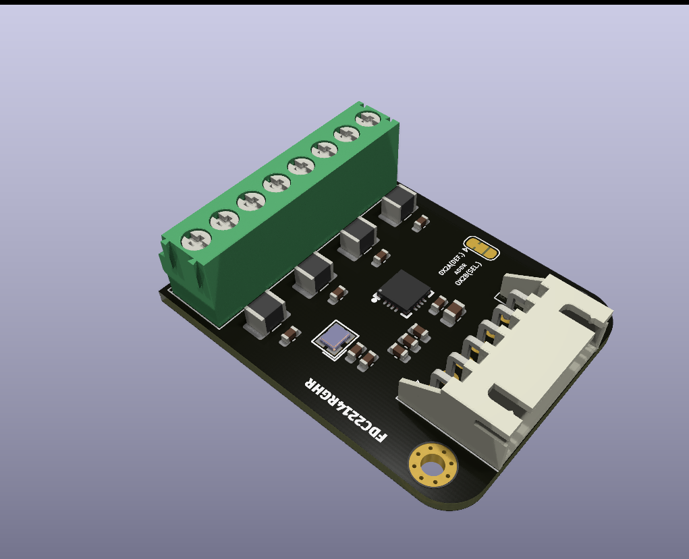
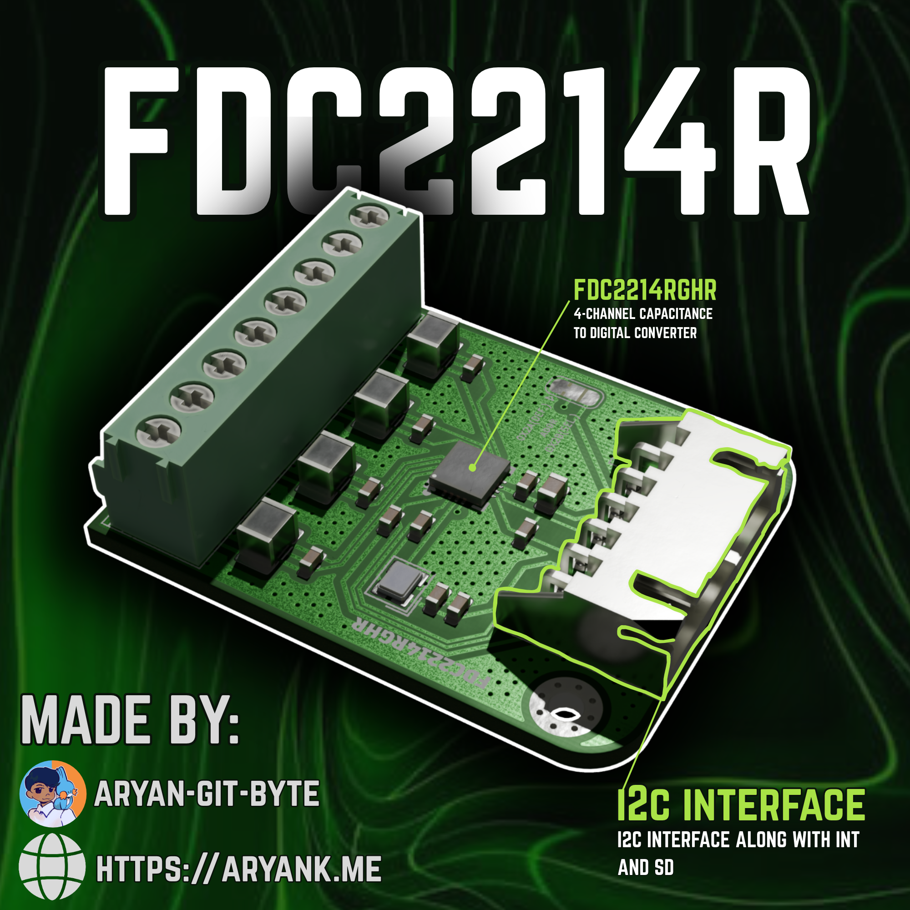

---
title: "FDC2214-Module"
author: "Aryan-git-byte"
description: "It is a 4-channel capacitance sensing module designed on the FDC2214 IC by Texas Instrument. This module can measure changes in capacitance using the onboard LC resonant sensors. it also provide four independant channels and can communicate with a MCU such as ESP32, Arduino etc over the standard I2C protocol."
---
# Entries:

```
Date: 06|11|2026
Title: Started working on the project
Lapse: https://lapse.hackclub.com/timelapse/4SQxoXW9ha_u
```
I started by studying a bit about the chip itself, then saw some reference schematics. After that i imported the symbol, footprint and 3d model from the easyeda to kicad using the easyeda2kicad tool and started drawing the schematic. I started by customising the symbol according to my ease of drawing, drew the power symbols, capacitors, some pull up resistors and the connector to interface it to MCU.
After that i searched about a 40 MHz active oscillator, and read its datasheet and added its output to the IC's CLKIN pin. 
after that i drew the resonance circuit,  and started assigning the footprints. The idea was to make it compact, so instead of using 4 separate 1x2 screw terminals i decided on a single 1x8 screw terminal. I also layouted the whole PCB before routing to ensure everything and added 2 mounting holes. 
 you can see, this is the PCB before routing, after that i started routing and my goal was to route everything on the same layer for which i had to move the two pull ups resistor many times, and yeah after i was done routing, there was only one single route on B.cu which was the jumper one. so it was good. 
in between routing i also put down all the silkscreen and labelled the pins, jumpers etc!
After i was done routing, i exported the file to blender, and rendered it which looked gorgeous:

and yeah it wasnt full cuz i forgot to resume it after i paused after pressing F12.

```
Date: 07|11|2026
Title: Completed the project
Lapse: https://lapse.hackclub.com/timelapse/6aHwk143kEXE
```
I started by searching the parts on LCSC, but LCSC didnt kept those oscillators so i shifted to Digikey, i added all the parts links and prices to each symbols BOM. this did took some times, but it was later worth since easy to order when i wanted to actually build it.
After that i started making the poster on the Canva using the render. also did i tell you, i used capacitors footprint instead of resistor :skull: so later i changed those too back to resistors.
After my poster was done which looked awesome 

I wrote the README.md and i was done. YAYAYA
Thanks <3