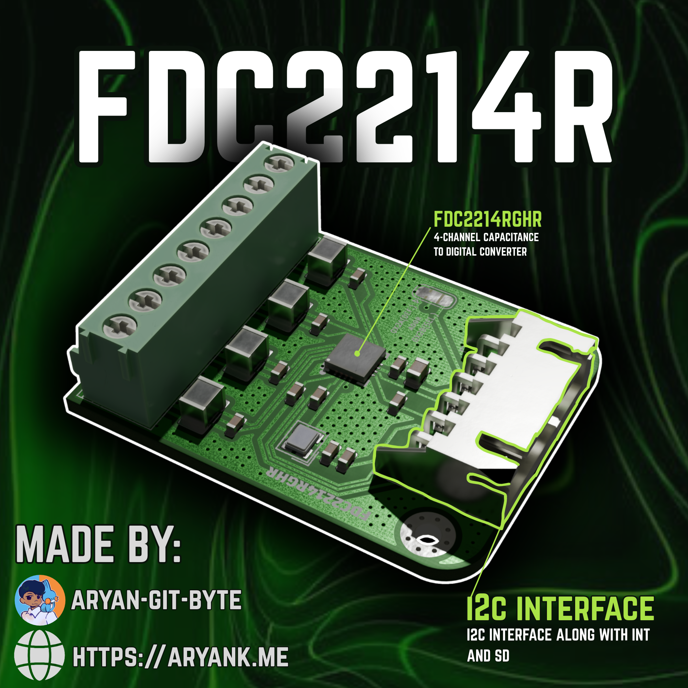
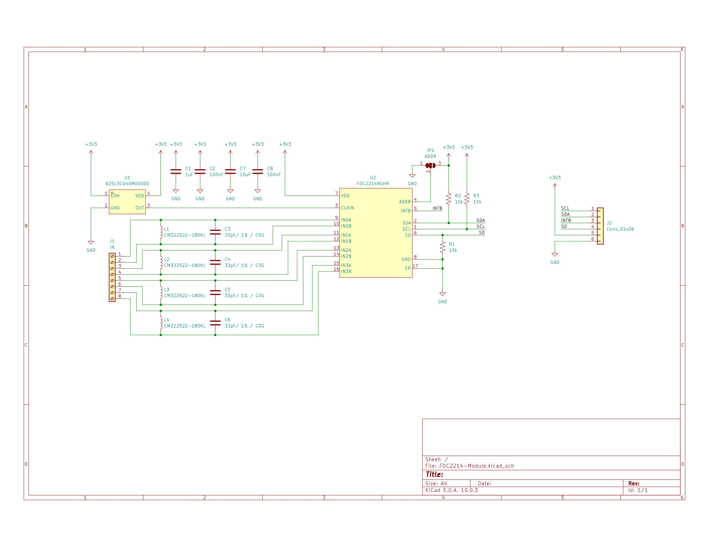
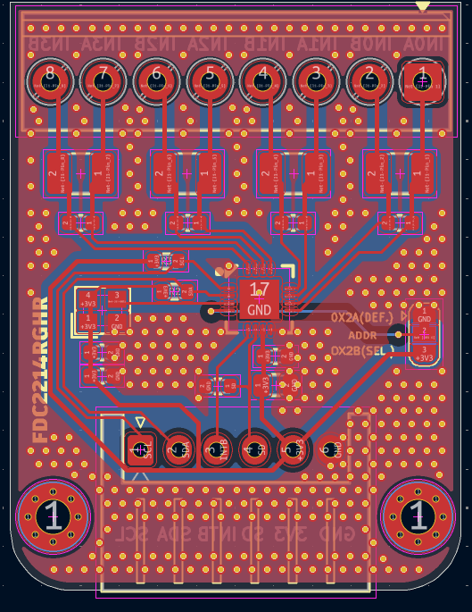
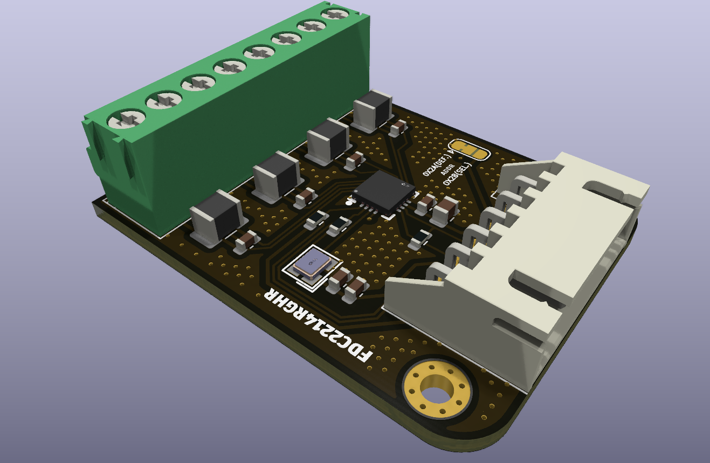

# FDC2214R MODULE

It is a 4-channel capacitance sensing module designed on the FDC2214 IC by Texas Instrument.
This module can measure changes in capacitance using the onboard LC resonant sensors. it also provide four independant channels and can communicate with a MCU such as ESP32, Arduino etc over the standard I2C protocol.

# Specifications:
- resolution upto 28-bit
- 40 MHz of external clock
- 4 independent channels
- I2C address (0X2A DEFAULT, 0X2B CONFIGURABLE) 
- Operating temperature of -40°C to +125°C (IC0)

# What is it for?
It is for applications such as Proximity sensors, gesture recognition or level sensors for liquids.

# Schematic: 

The schematic of this module is very straight forward having the main FDC2214 IC, a 40 MHz external active oscillator, some passives and 2 connectors. 

The module also offer a jumper you can use to configure the I2C address of the Module. Which is 0X2A in default, and 0X2B after shifting the jumper.

# PCB:

This is the front view of the PCB, i have tried to route all the things on the first layer itself except for that jumper pad, which i had to put on the otherside, and is routed from the B.cu

This is the 3d view of the PCB, lookin neat :D

# How to Build?
I have provided all the required files needed to reproduce this board in this repo.
- Gerber files: [Here](production/gerber_to_order/FDC2214-Module_29.6x38.6mm_for_JLCPCB.zip)

Just go to any of your PCB manufacturer and upload this gerber file, after that order all the components listed in [here](production/BOM.csv). I will be using Digikey to order my components, If you are also using Digikey you can use this csv to import things in your cart - [cart](production/Digikey-cart.csv)

After getting both of the things, solder them onto their place and use it!

# Reference:
- FDC2214 datasheet - https://www.ti.com/lit/ds/symlink/fdc2112.pdf

# License:
This repo comes under the MIT license.